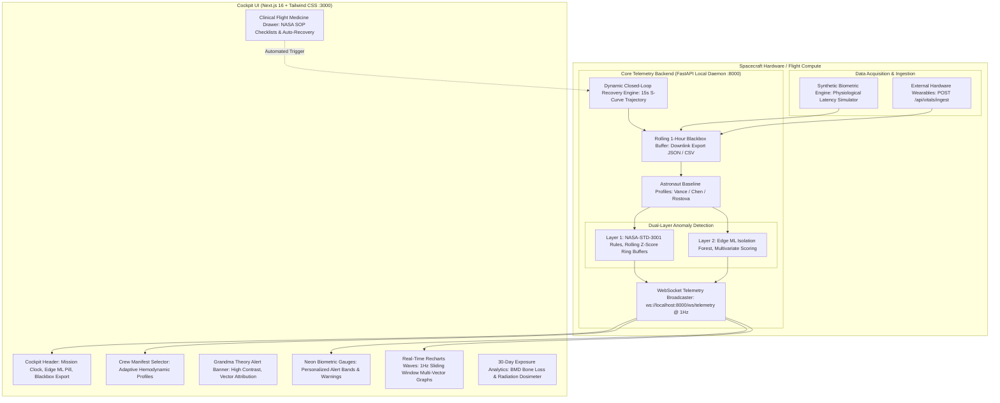
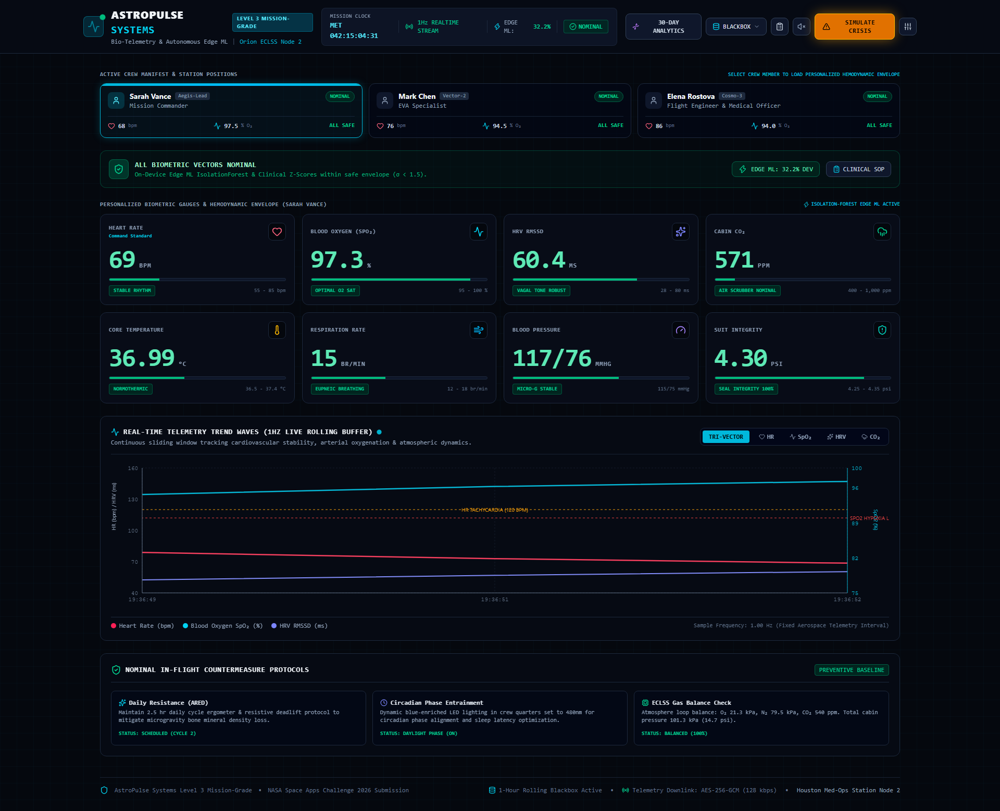
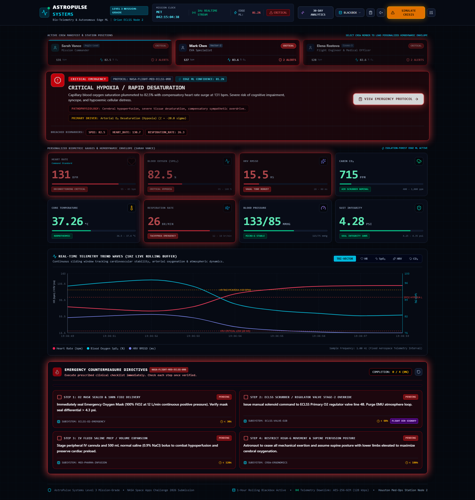
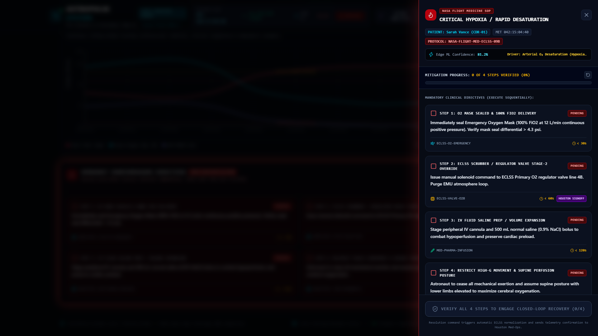
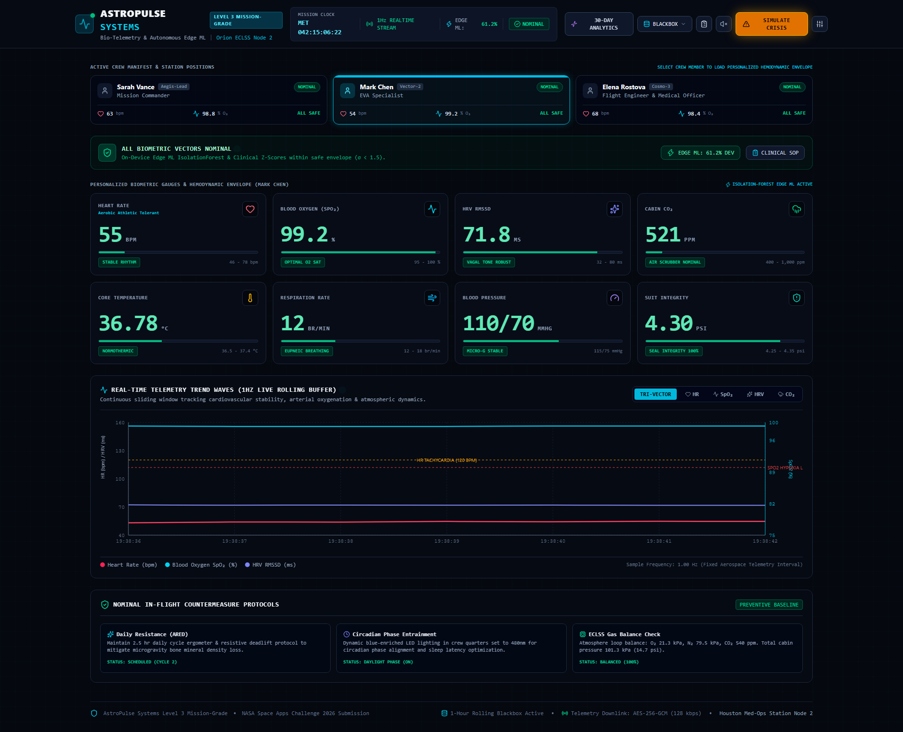
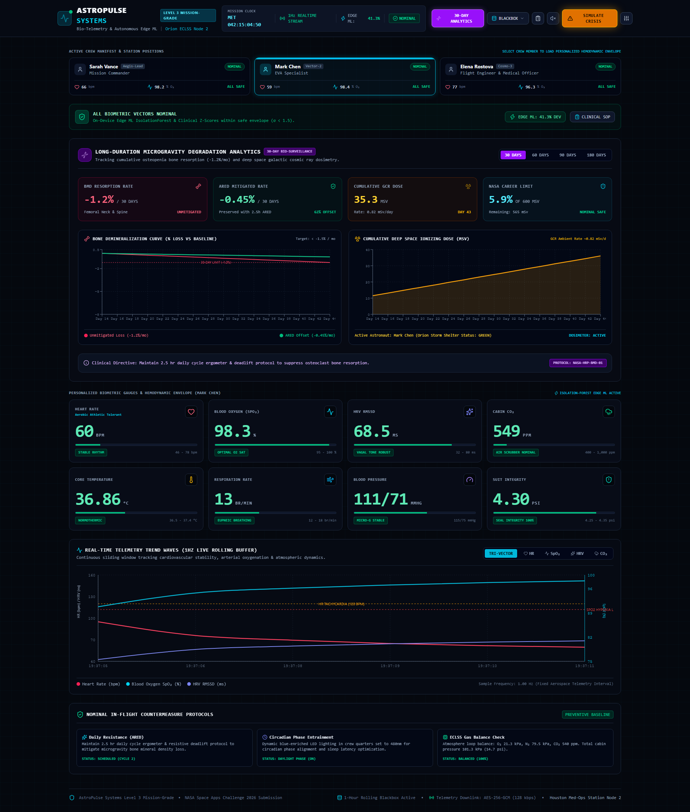
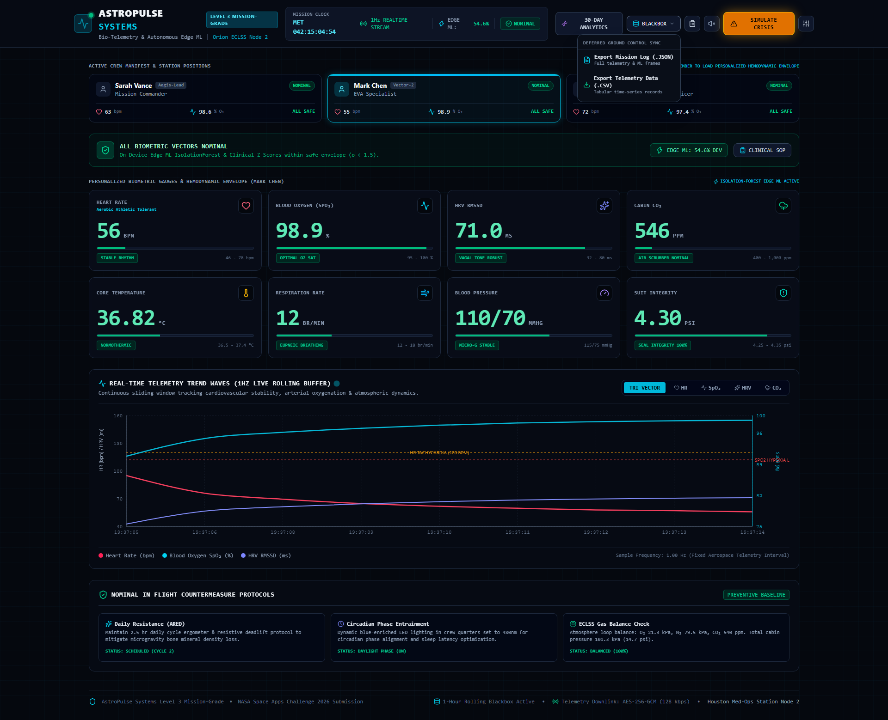

# AstroPulse Systems 🛰️⚡
### Autonomous Bio-Telemetry & Edge Clinical Resilience Cockpit for Deep Space Missions

[](https://frontend-alpha-pied-13.vercel.app)
[](https://youtu.be/062MgB7htsk)

[](https://opensource.org/licenses/MIT)
[](https://www.python.org/)
[-black.svg?logo=next.js&logoColor=white)](https://nextjs.org/)
[](https://fastapi.tiangolo.com/)
[](#zero-cloud-edge-architecture)
[](#nasa-standards--clinical-parameters)
[](#nasa-space-apps-challenge-2026)

---

## 📺 Project Demo Video

[](https://youtu.be/062MgB7htsk)

> 🎬 **Watch the Full Presentation & Live Cockpit Demo on YouTube**: [https://youtu.be/062MgB7htsk](https://youtu.be/062MgB7htsk)  
> *A high-definition walkthrough demonstrating real-time synthetic biometric streaming, on-device Edge ML anomaly isolation, NASA clinical SOP countermeasures, automated closed-loop recovery, and 30-day microgravity degradation analytics.*

---

## 🚀 Live Interactive Cockpit Demo

[](https://frontend-alpha-pied-13.vercel.app)

🔗 **Launch the Live Cockpit UI**:  
### 👉 **[https://frontend-alpha-pied-13.vercel.app](https://frontend-alpha-pied-13.vercel.app)**

> ⚡ **Autonomous Standalone Edge Mode**: AstroPulse Systems runs an on-device synthetic biometrics engine with real-time 1Hz streaming directly in your browser. You can switch crew members, trigger an acute in-flight hypoxia crisis, execute NASA clinical SOP checklists, and verify automated closed-loop recovery—**100% serverless with zero cloud dependencies.**

---

## 🌌 Mission Context & Problem Statement

During long-duration crewed transit—such as an **Artemis Orion lunar transit** or a **crewed Mars transit (3-year round trip)**—Earth is separated by **5 to 22 minutes of one-way radio latency** (up to 44 minutes round-trip). 

When an astronaut suffers an acute medical emergency—such as:
* Rapid cabin hypoxemic decompression,
* Acute hypercapnia from ECLSS $CO_2$ scrubber saturation,
* Microgravity orthostatic cardiac deconditioning,

**waiting for Ground Control in Houston is catastrophic.** Furthermore, modern commercial cloud AI services fail completely in deep space where internet connectivity is non-existent.

**AstroPulse Systems** solves this critical challenge by providing a **zero-cloud, edge-native bio-telemetry cockpit** running entirely on spacecraft flight hardware. It continuously analyzes high-frequency astronaut vitals, executes dual-layer ML anomaly detection on-device, provides actionable NASA Flight Medicine Standard Operating Procedures (SOPs), and drives automated closed-loop clinical physiological stabilization.

---

## 🚀 Key Architectural Innovations

### 1. Dual-Layer Edge Anomaly Detection (Rules + Multivariate ML)
* **Layer 1: Deterministic NASA-STD-3001 Rules & Dynamic Z-Scores**: Evaluates real-time values against individualized clinical limits and rolling statistical buffers ($\sigma$-score deviations).
* **Layer 2: On-Device `IsolationForest` Unsupervised Machine Learning**: Synthesizes multivariate metric vectors ($\text{HR}$, $\text{SpO}_2$, $\text{HRV RMSSD}$, $\text{Respiration Rate}$, $\text{Core Temp}$, $\text{Cabin } CO_2$) to compute an on-device Anomaly Confidence Score ($0 - 100\%$) and attribute the **primary contributing failure vector** without cloud APIs.

### 2. Personalized Astronaut Hemodynamic Envelopes
Different crew members possess vastly different baseline biometrics. AstroPulse adapts thresholds and models dynamically:
* **Commander Sarah Vance (`CDR-01`)**: Command baseline ($\text{HR } 62 \text{ bpm}$, $\text{HRV } 65 \text{ ms}$, nominal band $55 - 85 \text{ bpm}$).
* **EVA Specialist Mark Chen (`MS-02`)**: Athletic cardiovascular baseline ($\text{HR } 54 \text{ bpm}$, $\text{HRV } 72 \text{ ms}$, nominal band $46 - 78 \text{ bpm}$).
* **Flight Engineer & Medical Officer Elena Rostova (`FE-03`)**: Standard normotensive baseline ($\text{HR } 68 \text{ bpm}$, $\text{HRV } 58 \text{ ms}$, nominal band $60 - 90 \text{ bpm}$).

### 3. Dynamic Closed-Loop Clinical Recovery
AstroPulse bridges the gap between diagnostic telemetry and therapeutic intervention. When a crisis strikes:
1. The **Emergency SOP Drawer** presents step-by-step clinical directives (e.g. $O_2$ mask delivery, ECLSS valve override, IV saline infusion, supine posture).
2. As crew members verify each action, the **Mitigation Progress** gauge updates in real time.
3. Once all 4 countermeasures are verified, the system automatically engages an **autonomous 15-second physiological recovery trajectory**, driving astronaut oxygenation and cardiac rhythm back to nominal homeostasis without manual parameter resets.

### 4. Long-Duration Microgravity Degradation Analytics (30-Day Bio-Surveillance)
* **Osteopenia / Bone Mineral Density (BMD) Loss**: Models cumulative femoral neck and lumbar trabecular resorption ($-1.2\% \text{ per month}$) alongside ARED (Advanced Resistive Exercise Device) countermeasure preservation (preserving up to $62\%$).
* **Galactic Cosmic Ray (GCR) Dosimeter**: Tracks cumulative ionizing radiation dose ($\approx 0.82 \text{ mSv/day}$) benchmarked against NASA's lifetime career limit of $600 \text{ mSv}$.

### 5. Delayed Burst Blackbox Downlink Buffer
Maintains a rolling 1-hour circular telemetry buffer on-device. When deep-space communication windows open with Earth, Ground Control can execute a burst downlink of full telemetry frames and ML states in **JSON** or **CSV** formats.

### 6. External IoT Hardware Wearable Ingestion API
Includes a live `POST /api/vitals/ingest` endpoint for physical wearables, smart flight suits, or biomedical testbenches, instantly lighting up the **HARDWARE SENSOR LINKED** indicator badge in the cockpit.

---

## 🏛️ System Architecture



---

## 📸 Cockpit User Interface Showcase

| 1. Nominal Cockpit Baseline | 2. Acute In-Flight Crisis Alert |
| :---: | :---: |
|  |  |
| *Sarah Vance nominal envelope with 1Hz streaming and green status.* | *Critical Hypoxia emergency alert, Edge ML 81.2% confidence, SpO2 wave plunge.* |

| 3. NASA Clinical SOP Drawer | 4. Personalized Athletic Baseline (Mark Chen) |
| :---: | :---: |
|  |  |
| *NASA Flight Medicine directives with interactive checkboxes & mitigation progress.* | *EVA Specialist athletic baseline (HR 54 bpm, HRV 72 ms, 46–78 bpm envelope).* |

| 5. 30-Day Microgravity Degradation Analytics | 6. Blackbox Telemetry Downlink Menu |
| :---: | :---: |
|  |  |
| *Bone demineralization loss (-1.2%/mo vs ARED) and cosmic radiation dosimeter.* | *1-hour rolling buffer export in JSON / CSV for deferred Ground Control sync.* |

---

## 🔬 NASA Standards & Scientific Parameters

AstroPulse Systems adheres rigorously to official NASA space medicine and life-support specifications:

| Parameter | Nominal Range | Warning Threshold | Critical Emergency | NASA Source Standard |
| :--- | :--- | :--- | :--- | :--- |
| **Arterial Oxygenation ($\text{SpO}_2$)** | $95.0\% - 100.0\%$ | $< 92.0\%$ | $< 88.0\%$ | **NASA-STD-3001 Vol 2 §6.3** |
| **Heart Rate ($\text{HR}$)** | Profile-specific (e.g. $55 - 85 \text{ bpm}$) | $< 48 \text{ or } > 100 \text{ bpm}$ | $< 40 \text{ or } > 125 \text{ bpm}$ | **NASA-STD-3001 Vol 1 §4.2** |
| **Heart Rate Variability ($\text{RMSSD}$)** | $40 - 90 \text{ ms}$ | $< 28.0 \text{ ms}$ | $< 20.0 \text{ ms}$ | Autonomic Deconditioning Indicator |
| **Core Temperature** | $36.5^\circ\text{C} - 37.4^\circ\text{C}$ | $< 35.8^\circ\text{C} \text{ or } > 38.0^\circ\text{C}$ | $< 35.0^\circ\text{C} \text{ or } > 38.8^\circ\text{C}$ | **NASA SP-2010-3407 (HIDH)** |
| **Cabin Carbon Dioxide ($CO_2$)** | $350 - 1,000 \text{ ppm}$ | $> 1,800 \text{ ppm}$ | $> 3,000 \text{ ppm}$ | **Orion ECLSS Spec (JSC-63307)** |
| **Suit Atmosphere Pressure** | $4.25 - 4.35 \text{ psi}$ | $< 4.10 \text{ or } > 4.45 \text{ psi}$ | $< 3.90 \text{ psi}$ | **NASA EMU/xEMU Flight Envelope** |
| **Bone Mineral Density ($\text{BMD}$ Loss)** | $0.0\% - 0.4\%$ | $-0.8\% \text{ / 30 days}$ | $> -1.5\% \text{ / 30 days}$ | **NASA Human Research Program (HRP)** |
| **Cosmic Radiation Dose** | $< 1.0 \text{ mSv/day}$ | Cumulative $> 400 \text{ mSv}$ | Career Limit: $600 \text{ mSv}$ | **NASA Space Radiation Health Project** |

---

## 🛠️ Technology Stack

* **Backend Engine**:
  * [Python 3.11+](https://www.python.org/)
  * [FastAPI](https://fastapi.tiangolo.com/) with async WebSockets
  * [Scikit-Learn](https://scikit-learn.org/) (`IsolationForest` unsupervised model)
  * [NumPy](https://numpy.org/) (vectorized Z-score & statistical anomaly computation)
  * [Uvicorn](https://www.uvicorn.org/) (high-performance ASGI server)
* **Cockpit Interface**:
  * [Next.js 16](https://nextjs.org/) (React 19, Turbopack)
  * [Tailwind CSS](https://tailwindcss.com/) (high-contrast, dark cockpit aesthetic conforming to Grandma Theory legibility)
  * [Recharts](https://recharts.org/) (real-time canvas rendering for multi-vector biometric waves)
  * [Lucide React](https://lucide.dev/) (aerospace iconography)
  * Web Audio API Synthesizer (pure client-side audio for sonar, cautions, and emergency alarms with zero asset latency)
* **Automation & Presentation**:
  * [Playwright](https://playwright.dev/) (headless browser telemetry capture & recording)
  * [FFmpeg](https://ffmpeg.org/) (video encoding and muxing)
  * [edge-tts](https://github.com/rany2/edge-tts) (neural speech synthesis)

---

## 💻 Step-by-Step Local Setup & Execution

### Prerequisites
* **Python 3.11+** installed
* **Node.js 18+** & `npm` installed
* **Git** installed

### 1. Clone the Repository
```bash
git clone https://github.com/fokrulanthro16-eng/astropulse-systems.git
cd astropulse-systems
```

### 2. Start the Backend (FastAPI)
```bash
cd backend
python -m venv venv

# Windows
.\venv\Scripts\activate
# Linux / macOS
source venv/bin/activate

pip install -r requirements.txt
python -m uvicorn app.main:app --host 127.0.0.1 --port 8000
```
*API docs will be available at:* `http://127.0.0.1:8000/docs`  
*Telemetry WebSocket:* `ws://127.0.0.1:8000/ws/telemetry`

### 3. Start the Frontend Cockpit (Next.js)
In a second terminal window:
```bash
cd frontend
npm install
npm run dev -- --port 3000
```
*Open your browser at:* `http://localhost:3000`

### 4. One-Click Automated Launcher (Windows)
Alternatively, start both servers simultaneously:
```powershell
.\start_all.ps1
```
*(Or run `start_all.bat` on Windows Command Prompt).*

---

## 🧪 Automated Testing & Verification

AstroPulse Systems includes automated integration and verification test suites validating the end-to-end edge pipeline:

```bash
# Run Level-3 mission verification tests (baselines, ML scoring, closed-loop recovery)
python backend/test_level3_verification.py

# Run screenshot test suite
python capture_all_screenshots.py

# Re-generate the full 1080p demo presentation with voiceover
python generate_demo_video.py
```

---

## 📄 License & Open-Source Attribution

This project is licensed under the **MIT License** — see the [LICENSE](LICENSE) file for details.  
Copyright © 2026 **Fokrul Islam**.

Developed for the **NASA Space Apps Challenge 2026** — *Astronaut Health Monitoring & Autonomous Edge Medical Decision Support*.
